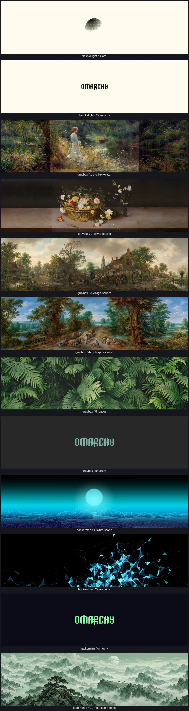
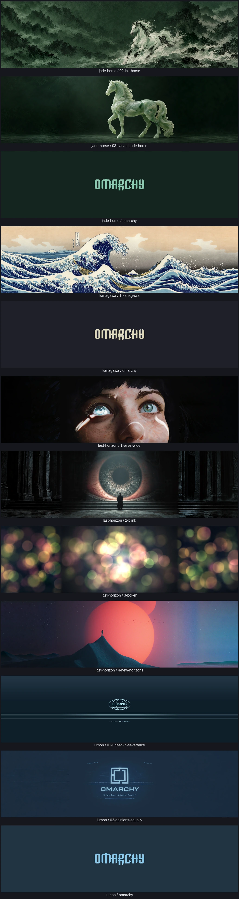
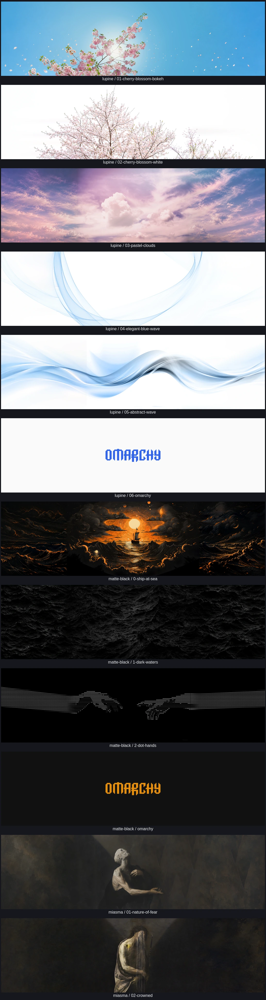
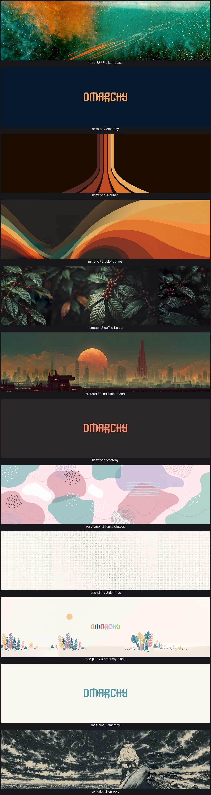
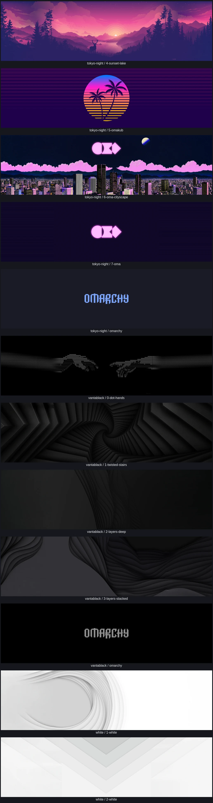

# 32:9 background gallery

All 98 compositions, rendered at 5120×1440 and reduced for this review gallery. The runtime assets retain their full original source images.

[Before and after: Gruvbox 1–2, Last Horizon 2–4, and Matte Black 2](revision-comparison.webp). All original center artwork remains unchanged.

## catppuccin, catppuccin-latte, ethereal, everforest

## flexoki-light, gruvbox, hackerman, jade-horse

## jade-horse, kanagawa, last-horizon, lumon

## lupine, matte-black, miasma

## miasma, nord, retro-82

## retro-82, ristretto, rose-pine, solitude

## solitude, starship, tokyo-night

## tokyo-night, vantablack, white

## white

